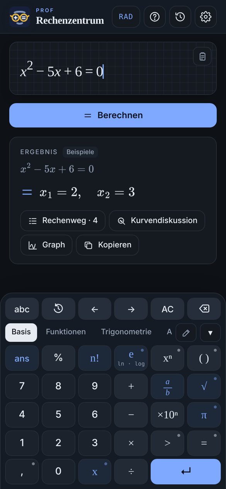
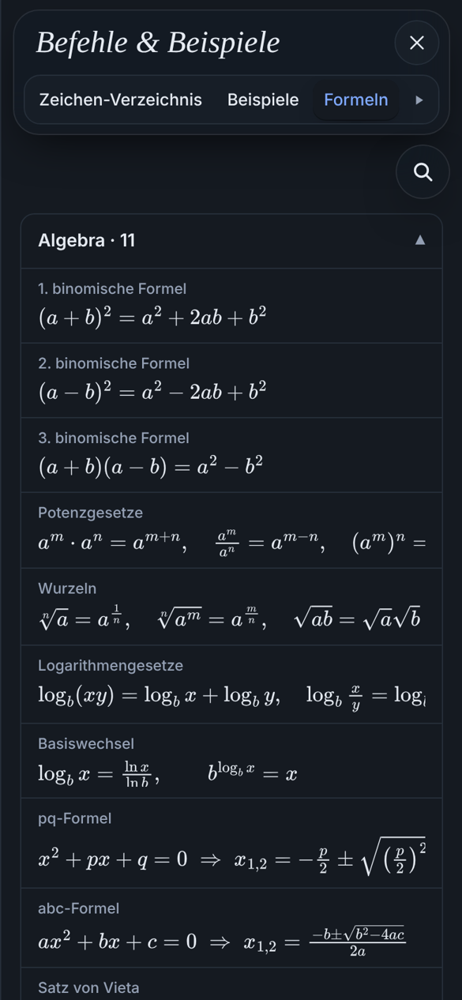

# Prof Rechenzentrum

**CAS-Taschenrechner im Browser – mit Rechenweg.**
Angelehnt an Math42 und den TI-Nspire CAS, gebaut fürs iPhone, läuft aber in jedem modernen Browser.

👉 **Live:** [mrkero.github.io/Prof-Rechenzentrum](https://mrkero.github.io/Prof-Rechenzentrum/)

<p align="center">
  
  &nbsp;&nbsp;
  
</p>

## Was kann der Rechner?

**Algebra**
- Exakte Rechnung mit Brüchen, Wurzeln, π und e – inklusive Rechenweg
- Gleichungen und Ungleichungen mit Definitionsbereich
- Polynomdivision Schritt für Schritt; pq-Formel, abc-Formel oder binomische Formel wählbar
- Lineare Gleichungssysteme mit ausführlichem Gauß-Verfahren (Stufenform, Rückwärtseinsetzen, Parameter)
- Folgen und Reihen (`folge`, `reihe`, `rekursiv`, `muster`)
- Komplexe Zahlen mit Polarform

**Analysis**
- Ableitungen, eigene Funktionen `f`, `g`, `h` mit f′, f″, f⁽ⁿ⁾
- Integrale mit Standardintegral-Tabelle, uneigentliche Integrale, Fläche zwischen zwei Funktionen
- Grenzwerte (ein- und beidseitig), Stetigkeit (`stetig`)
- Kurvendiskussion mit Nullstellen, Extrema, Wendepunkten und Polstellen
- Differentialgleichungen (`dgl`): getrennte Veränderliche, linear 1. Ordnung, 2. Ordnung mit konstanten Koeffizienten, Anfangswerte

**Mehrdimensional**
- Mehrfachintegrale (`iint`, `iiint`), Kurvenintegrale (`kurvenint`, `bogen`)
- Vektoranalysis: `grad`, `div`, `rot`, `laplace`
- 3D-Flächen (`surface`) mit Extrempunkten (`extrema`)

**Matrizen und Statistik**
- Matrix-Editor mit echter 2D-Darstellung von Matrizen und Vektoren
- Regression (`regr`) mit Dateneditor, Modellwahl und R²

**Graphen**
- 2D-Graph mit Schnittpunkten, Flächen, automatischem oder manuellem Bereich und Wertetabelle
- Parameter- und Polarkurven

**Hilfe**
- Zeichen-Verzeichnis, Beispiele, Formelsammlung (inklusive Chemie), Integraltabelle und interaktiver Einheitskreis

**Bedienung**
- Eigene Tastatur mit Reitern (Basis, Funktionen, Trigonometrie, Algebra, Matrix, Stochastik …) und Langdruck-Varianten
- Tastenlayout im Bearbeiten-Modus anpassbar
- Verlauf, heller und dunkler Modus, 13 Sprachen

## Auf dem iPhone installieren

Seite in Safari öffnen → Teilen → **Zum Home-Bildschirm**. Danach startet der Rechner wie eine App im Vollbild.

## Aufbau

Der Rechner ist eine einzige HTML-Datei ohne Server. Die Bibliotheken kommen von einem CDN:
[MathQuill](https://github.com/mathquill/mathquill) (Eingabe), [MathJax](https://www.mathjax.org/) (Darstellung),
[math.js](https://mathjs.org/) und [nerdamer](https://nerdamer.com/) (Rechenkern).

```
index.html      fertige App (wird von GitHub Pages ausgeliefert)
version.json    aktuelle Versionsnummer für die Update-Prüfung
src/
  index.html    Gerüst, Styles, Einstellungen
  engine.js     Rechenkern und Rechenwege
  editor.js     Umwandlung LaTeX ⇄ Text, Matrix-Embeds
  ui.js         Oberfläche, Tastatur, Graphen, Verlauf
  extras.js     Formelsammlung, Einheitskreis, 3D-Flächen
  i18n.js       Übersetzungen
  glossary.js   Zeichen-Verzeichnis
  logos.js      Logo
build.py        setzt src/ zu einer Datei zusammen
```

### Neu bauen

```bash
python3 build.py
cp dist/pages/index.html dist/pages/version.json .
```

`build.py` erwartet die Bibliotheken unter `test/node_modules` (für das MathQuill-CSS und die lokale Testseite):

```bash
mkdir -p test && cd test && npm install jquery@3.7.1 mathquill@0.10.1 mathjs@12.4.2 mathjax@3.2.2 nerdamer@1.1.13
```

Vor jeder Veröffentlichung `APP_VERSION` in `src/index.html` erhöhen – die App vergleicht sie mit `version.json` und zeigt so an, dass ein Update bereitsteht.
